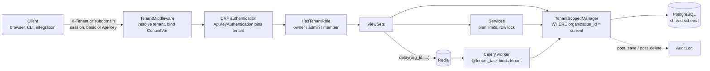

# tenantforge

A small, production-shaped starter for multi-tenant SaaS on Django 4.2 LTS and Django REST
Framework. All tenants share one database and one schema; every tenant-owned row carries an
`organization_id`, and the ORM refuses to read or write tenant data without an active tenant.

## Why

Most multi-tenant bugs are not exotic. They come from a single `Model.objects.all()` that
forgot a `.filter(organization=...)`. tenantforge moves that filter out of developers' hands:

- the default manager filters by the current tenant automatically;
- a query with no tenant raises `TenantNotSetError` instead of returning everyone's rows;
- a write to a row of another tenant raises `CrossTenantWriteError`;
- the isolation guarantees are covered by a dedicated test suite (ORM and HTTP).

## Features

- `Organization` (the tenant) and `Membership` with roles: `owner`, `admin`, `member`
- Tenant resolution middleware: `X-Tenant: <slug>` header or `<slug>.<TENANT_BASE_DOMAIN>`
- `TenantScopedModel` mixin + `TenantScopedManager`, backed by a `contextvars.ContextVar`
- Per-tenant API keys: random 256-bit secret, SHA-256 hash stored, public prefix shown
- Sample domain app (`projects`, `tasks`) built on the mixin
- DRF permission class driven by the caller's role in the active tenant
- Plan limits (`free` / `pro`: projects, seats) enforced in the service layer under a row lock
- Audit log written from model signals, with the acting user or API key
- `@tenant_task` decorator for Celery jobs that run inside one tenant (eager in tests)
- Settings split (`base` / `dev` / `test` / `prod`) driven by environment variables
- SQLite for tests, PostgreSQL + Redis in `docker-compose`

## Isolation model

| Layer | Guard |
|---|---|
| Request | `TenantMiddleware` resolves the tenant, binds it to a context variable, and resets it when the response leaves. Unknown slug → `404`. |
| Authentication | An API key belongs to exactly one organization. A key sent to another tenant → `401`. |
| Authorization | `HasTenantRole` requires a membership (or key role) in the active tenant. Non-member → `403`. |
| Reads | `Model.objects` filters by the active tenant; no tenant → `TenantNotSetError`. Another tenant's id → `404`. |
| Writes | `save()`, `delete()` and `bulk_create()` assign or verify `organization_id`. Mismatch → `CrossTenantWriteError`. |
| Relations | Related-field querysets (`Project.objects`) are evaluated per request, so a foreign id from another tenant fails validation (`400`). `Task.save()` also checks that its project shares its tenant. |
| Workers | Celery tasks receive an organization id and run inside `tenant_context(org)`. |

Escape hatches are explicit and greppable: `Model.all_tenants` (plain manager) and the
`unscoped()` context manager.

```python
from tenantforge.tenancy.context import tenant_context, unscoped

with tenant_context(acme):
    Project.objects.all()  # only Acme's projects
    Project.objects.create(name="Roadmap")  # organization set automatically

Project.objects.all()  # raises TenantNotSetError

with unscoped():
    Project.objects.count()  # all tenants, on purpose
```

## Architecture



Project layout:

```
config/                 settings (base/dev/test/prod), urls, celery app
tenantforge/tenancy/    organizations, memberships, API keys, context, manager,
                        middleware, auth, permissions, plans, services, task helper
tenantforge/projects/   sample domain: projects and tasks
tenantforge/audit/      audit log model, signal hooks, read-only API
tests/                  ORM isolation, API isolation, roles, plans, audit, Celery
```

## Quick start

With Docker:

```bash
docker compose up --build
docker compose exec web python manage.py createsuperuser --username alice
```

Locally (SQLite, Celery eager):

```bash
python3 -m venv .venv
.venv/bin/pip install -e ".[dev]"
CELERY_TASK_ALWAYS_EAGER=true .venv/bin/python manage.py migrate
CELERY_TASK_ALWAYS_EAGER=true .venv/bin/python manage.py runserver
```

Set `POSTGRES_DB` (and friends, see `.env.example`) to switch the dev settings to PostgreSQL.

## API examples

Create an organization (the caller becomes its owner):

```bash
curl -u alice:password -X POST localhost:8000/api/organizations/ \
     -H 'Content-Type: application/json' -d '{"name": "Acme", "slug": "acme"}'
```

Work inside the tenant, by header or by subdomain:

```bash
curl -u alice:password -H 'X-Tenant: acme' -X POST localhost:8000/api/projects/ \
     -H 'Content-Type: application/json' -d '{"name": "Roadmap"}'

curl -u alice:password http://acme.localhost:8000/api/projects/
```

Plan usage and the caller's role:

```bash
curl -u alice:password -H 'X-Tenant: acme' localhost:8000/api/organizations/current/
# {"slug": "acme", "plan": "free", "role": "owner",
#  "usage": {"projects": 1, "max_projects": 3, "seats": 1, "max_seats": 3}, ...}
```

Invite a member, issue an API key (the raw key is returned once), then use it.
The key pins the tenant, so no `X-Tenant` header is needed:

```bash
curl -u alice:password -H 'X-Tenant: acme' -X POST localhost:8000/api/members/ \
     -H 'Content-Type: application/json' -d '{"username": "carol", "role": "member"}'

curl -u alice:password -H 'X-Tenant: acme' -X POST localhost:8000/api/api-keys/ \
     -H 'Content-Type: application/json' -d '{"name": "ci", "role": "member"}'
# {"id": 1, "prefix": "3f9a0c1e", "key": "tf_3f9a0c1e_...", ...}

curl -H 'Authorization: Api-Key tf_3f9a0c1e_...' localhost:8000/api/tasks/?status=todo
```

Queue a per-tenant background job and read the audit trail:

```bash
curl -u alice:password -H 'X-Tenant: acme' -X POST localhost:8000/api/projects/1/summarize/
curl -u alice:password -H 'X-Tenant: acme' 'localhost:8000/api/audit-logs/?action=project.created'
```

| Endpoint | Read | Write |
|---|---|---|
| `/api/organizations/` | any authenticated user (own orgs) | any authenticated user |
| `/api/organizations/current/` | member | — |
| `/api/projects/` | member | admin (`summarize`: member) |
| `/api/tasks/` | member | member |
| `/api/members/` | member | admin (adding owners: owner) |
| `/api/api-keys/` | admin | admin |
| `/api/audit-logs/` | admin | — |

## Design decisions

**Shared schema with row-level isolation, not schema-per-tenant.** One schema keeps
migrations a single, fast operation, works with connection poolers such as PgBouncer in
transaction mode, needs no `search_path` switching, and makes cross-tenant reporting a normal
query run under `unscoped()`. Schema-per-tenant gives stronger physical separation but costs a
migration run per tenant, catalog bloat at thousands of schemas, and harder pooling. For
products with many small tenants, the shared schema is the better default; the guards above make
the missing-filter bug fail loudly instead of leaking data. PostgreSQL row-level security can be
added on top as a second line of defence.

**A context variable, not a thread-local.** `ContextVar` is correct for threads and for asyncio
tasks, and the middleware resets it with the token it got, so nothing leaks between requests.

**Refuse instead of returning everything.** An unscoped query raises. The cost is an explicit
`unscoped()` in admin scripts; the benefit is that the dangerous default does not exist.

**No class-level `queryset` on viewsets.** `Project.objects.all()` at import time would run
before any tenant exists. Views build querysets in `get_queryset()`, and serializer fields
receive the manager so DRF evaluates it per request.

**Limits in services, under a lock.** `create_project` and `add_member` lock the organization row
(`SELECT ... FOR UPDATE` on PostgreSQL) before counting, so two concurrent requests cannot both
take the last slot.

**API keys are hashed with SHA-256.** Keys are 256-bit random values, so a slow password hash
would add latency without adding security. Lookup is by public prefix, comparison is
constant-time.

**Unknown tenant is 404, foreign object is 404.** Responses never confirm that another tenant's
slug or object exists.

What it deliberately does not include: per-tenant databases, billing integration, a Django
admin wired for scoped managers, or an invitation email flow.

## Running tests

```bash
.venv/bin/pytest            # SQLite in memory, Celery eager
.venv/bin/ruff check .
.venv/bin/ruff format --check .
```

The suites:

- `tests/test_orm_isolation.py` — manager filtering, refusal without a tenant, cross-tenant
  save/delete/bulk_create, cross-tenant relations, context reset
- `tests/test_api_isolation.py` — header and subdomain resolution, non-members, foreign ids,
  foreign foreign-keys, API key tenant pinning and revocation
- `tests/test_permissions_and_plans.py` — roles, API key lifecycle, plan limits, audit log,
  Celery tasks bound to a tenant

CI runs ruff, a migrations check and pytest on Python 3.12. The code also runs on Python 3.9+.

## License

MIT — see [LICENSE](LICENSE).

Author: Ahmed Mahdy
